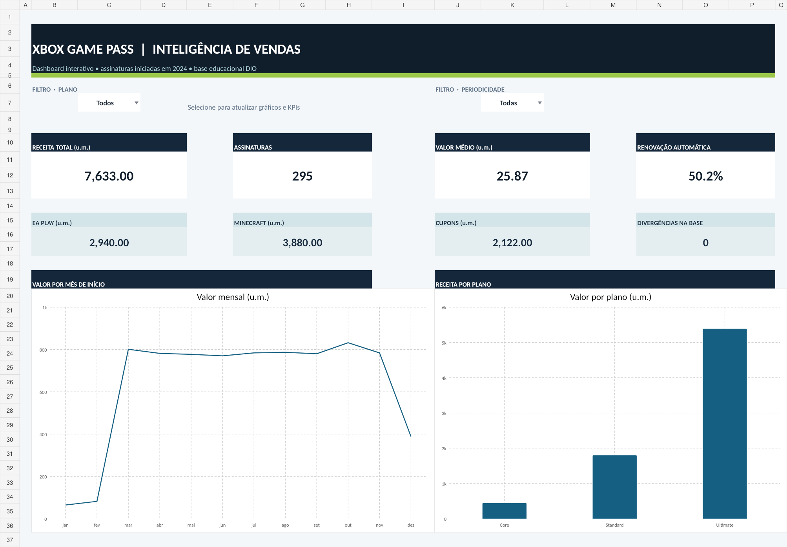
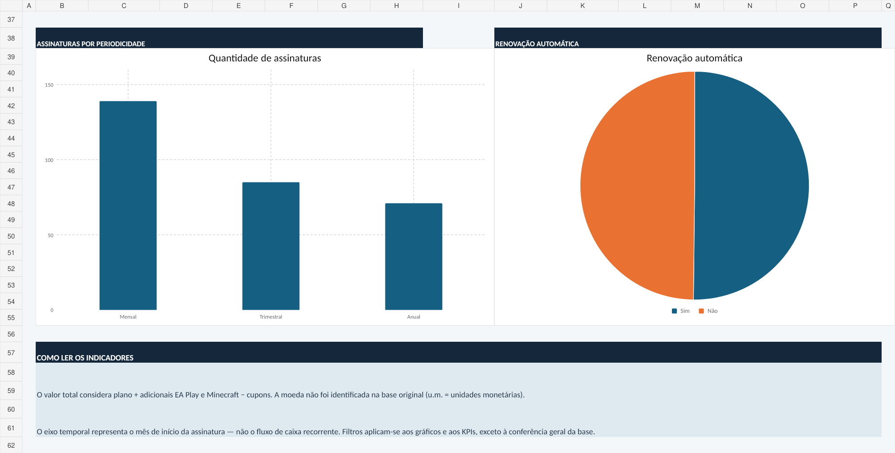

# Dashboard de Vendas | Xbox Game Pass no Excel

Projeto prático desenvolvido para o desafio **Dashboard de Vendas no Excel**, da **DIO**. A solução transforma uma base educacional de assinaturas do Xbox Game Pass em um painel gerencial com indicadores, filtros e gráficos que ajudam a entender a composição dos valores registrados.

## Visão geral

## Principais funcionalidades

- **Filtros interativos por plano e periodicidade:** altere os seletores nas células `PAINEL!C7` e `PAINEL!K7`.
- **Indicadores:** valor total, número de assinaturas, valor médio por registro e percentual com renovação automática.
- **Composição dos valores:** componentes de EA Play, Minecraft e descontos por cupons.
- **Quatro visualizações:** valor por mês de início, valor por plano, quantidade por periodicidade e distribuição da renovação automática.
- **Verificação automática:** cada registro tem um indicador de consistência entre total e componentes.
- **Dados tabulares e cálculos rastreáveis:** tabelas e agregações podem ser consultadas no próprio Excel.

## Indicadores da base completa

| Indicador | Resultado |
|---|---:|
| Registros de assinaturas | **295** |
| Total de valores registrados | **7.633,00 u.m.** |
| Valor médio por assinatura | **25,87 u.m.** |
| Assinaturas com renovação automática | **148 (50,17%)** |
| Valores associados ao EA Play | **2.940,00 u.m.** |
| Valores associados ao Minecraft | **3.880,00 u.m.** |
| Total de descontos por cupons | **2.122,00 u.m.** |
| Divergências identificadas na conferência | **0** |

> **Nota metodológica:** a base não identifica explicitamente sua moeda, por isso usamos **u.m. (unidades monetárias)**. O eixo mensal agrupa registros pela **data de início das assinaturas em 2024**, não por faturamento recorrente efetivamente recebido em cada mês. Estes indicadores descrevem os registros fornecidos; não representam métricas oficiais de uma empresa.

## Como executar

1. Baixe o arquivo [`Dashboard_Vendas_Xbox_Game_Pass_DIO.xlsx`](Dashboard_Vendas_Xbox_Game_Pass_DIO.xlsx).
2. Abra no **Microsoft Excel** para desktop, preferencialmente com o cálculo automático habilitado.
3. Entre na guia **PAINEL**. Os seletores ficam nas células `C7` e `K7`.
4. Escolha um plano e/ou uma periodicidade. Selecione **Todos** e **Todas** para mostrar a base completa novamente.
5. Consulte as guias **DADOS**, **ANALISE** e **GUIA** para verificar a origem e os cálculos.

O projeto funciona com recursos nativos do Excel; não exige macros, VBA, complementos ou conexão com serviços externos. O arquivo contém dados agregados a partir da base educacional fornecida pela DIO, com **nomes pessoais removidos** da versão publicada.

## Estrutura do arquivo Excel

| Guia | Conteúdo |
|---|---|
| **PAINEL** | Filtros, indicadores e gráficos interativos |
| **DADOS** | 295 registros, valores, datas e coluna de conferência |
| **ANALISE** | Consolidações por mês, plano, periodicidade e renovação |
| **GUIA** | Orientações de leitura e limitações |

## Fórmulas e critérios

- **Total por registro** = preço do plano + adicional EA Play + adicional Minecraft − valor de cupom.
- **Valor agregado** = soma dos totais dos registros que atendem aos filtros.
- **Valor médio** = valor agregado ÷ quantidade de registros filtrados.
- **Taxa de renovação automática** = registros com resposta `Sim` ÷ registros filtrados.
- **Conferência** = a coluna N da guia `DADOS` identifica diferenças entre o total e seus componentes.

Utilizam-se, entre outras, as funções **SOMASES / SUMIFS**, **CONT.SES / COUNTIFS**, **SE / IF**, **SEERRO / IFERROR** e **DATA / DATE**. O Excel pode apresentar os nomes localizados das funções conforme o idioma instalado.

## Documentação

- [Guia rápido de uso](GUIA_DE_USO.md)
- [Metodologia, auditoria e limitações](METODOLOGIA_E_TESTES.md)
- [Roteiro de entrega do desafio DIO](ENTREGA_DIO.md)

## Origem

Arquivos de apoio do desafio DIO **Dashboard de Vendas no Excel**: `base.xlsx` (fonte de registros) e `dashboard_xbox_finalizado.xlsx` (referência didática de layout e análises). O dashboard desta entrega foi estruturado como uma solução própria a partir desses materiais. O repositório contém somente o Excel final e a documentação necessária para reproduzir os indicadores.

**Uso:** material de demonstração e aprendizado. A publicação pública é feita sem nomes de assinantes. Nenhum cálculo substitui apuração financeira ou contábil.
